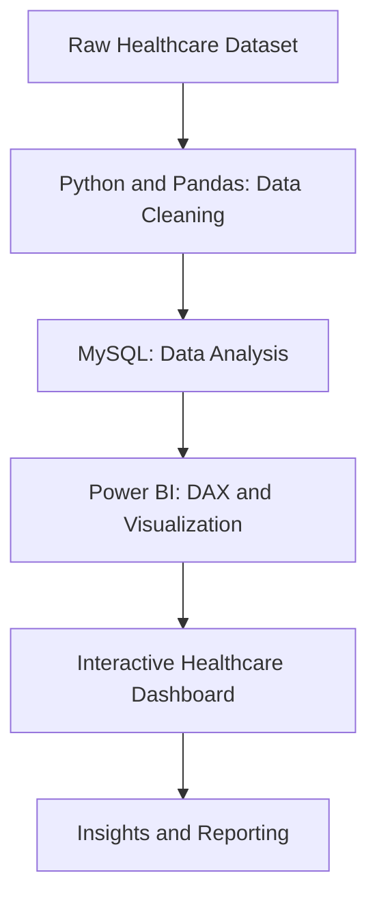
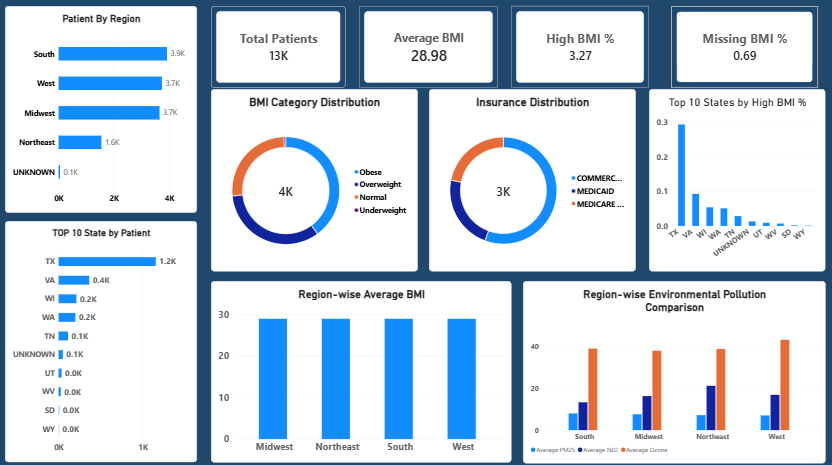

# Healthcare Data Analytics | Python, SQL & Power BI

## Project Overview

An end-to-end healthcare analytics project that transforms raw patient data into meaningful insights through Python, MySQL and Power BI. The analysis focuses on patient demographics, BMI patterns, insurance coverage, regional health trends and environmental indicators.

## Project Objectives

- Clean and prepare healthcare data for analysis.
- Identify patient distribution across regions and states.
- Analyze BMI categories and high BMI percentages.
- Explore insurance coverage and differences across payer categories.
- Examine regional environmental pollution indicators.
- Present actionable descriptive insights through an interactive dashboard.

## Tools & Technologies

| Technology | Purpose |
|---|---|
| Python | Data preprocessing and exploratory analysis |
| Pandas | Data cleaning, transformation and descriptive statistics |
| MySQL / MySQL Workbench | Database management and SQL analysis |
| Power BI Desktop | Interactive dashboard development |
| DAX | Calculated columns, measures and KPIs |

## Dataset

**Source:** WiDS Datathon 2024 — Challenge 1 (`wids_training.csv`)

- Original records: **12,906**
- Original columns: **83**
- Data includes patient characteristics, insurance information, geographic attributes, cancer-related diagnoses, community demographics and environmental indicators.
- Key fields: `patient_id`, `patient_age`, `patient_race`, `payer_type`, `patient_state`, `Region`, `bmi`, `PM25`, `Ozone`, `N02`.

## Project Workflow



## 1. Data Cleaning Using Python

- Inspected data dimensions, data types and missing values.
- Checked for duplicate records and numeric outliers.
- Examined missingness in BMI, demographic and insurance fields.
- Prepared the dataset for SQL analysis and visualization.

## 2. Data Analysis Using MySQL

Performed analytical queries covering:

- Total patient records and regional distribution.
- State-wise patient counts and average BMI.
- Insurance coverage and payer distribution.
- High BMI percentages across regions, insurance types and demographic groups.
- Regional and state-level environmental pollution indicators.

SQL concepts applied include `SELECT`, `WHERE`, `GROUP BY`, `HAVING`, `ORDER BY`, `COUNT`, `AVG` and `CASE`.

## 3. Power BI Dashboard

**Dashboard name:** Healthcare Patient Analytics Dashboard

### Key Performance Indicators (KPIs)

- Total Patients
- Average BMI
- High BMI Percentage
- Missing BMI Percentage

### Dashboard Visualizations

- Patients by Region
- Top 10 States by Patient Count
- BMI Category Distribution
- Insurance Type Distribution
- Region-wise Average BMI
- Region-wise Environmental Pollution Comparison
- Top 10 States by High BMI Percentage

### Dashboard Preview



*Current Power BI dashboard screenshot. The High BMI and Missing BMI cards require percentage-format and measure validation; the state visuals also include UNKNOWN and should be reviewed before publication. The dataset-level findings below are distinct from the current dashboard display.*

### Example DAX Measure

```dax
High BMI % =
DIVIDE(
    CALCULATE(
        COUNTROWS('healthcare_db healthcare_patients'),
        'healthcare_db healthcare_patients'[bmi] > 30
    ),
    COUNT('healthcare_db healthcare_patients'[bmi]),
    0
)
```

High BMI percentage is calculated among records with available BMI values. This project uses BMI greater than 30 for this measure.

## Key Findings

The following figures were verified against the original CSV dataset.

| Metric | Result |
|---|---:|
| Total patient records | 12,906 |
| Average BMI (available records) | 28.98 |
| Records with available BMI | 3,941 |
| Missing BMI percentage | 69.46% |
| High BMI percentage (BMI > 30) | 38.62% |
| South region records | 3,919 |
| West region records | 3,735 |
| Midwest region records | 3,650 |
| Northeast region records | 1,550 |

- The South has the highest patient count among the four named regions.
- The average recorded BMI falls within the conventional adult overweight range.
- More than one-third of records with available BMI have a BMI above 30.
- High BMI missingness is an important data quality concern and may affect the representativeness of BMI-related findings.

## How to Reproduce the Project

1. Obtain the WiDS Datathon 2024 Challenge 1 dataset and review its usage terms.
2. Install Python, Pandas, MySQL Workbench and Power BI Desktop.
3. Load and prepare the CSV dataset using Python.
4. Import the prepared data into MySQL and execute analytical queries.
5. Connect Power BI to MySQL or import the prepared data.
6. Create DAX measures, calculated columns and dashboard visualizations.

## Limitations

- Findings describe the supplied dataset, not the general population.
- Missing BMI and demographic values may introduce bias.
- Geographic pollution indicators do not establish individual exposure or causal relationships.
- Different pollutants may use different units and should not be interpreted as directly comparable health risks.
- The project is descriptive analytics, not a clinical prediction or patient readmission model.

## Future Improvements

- Perform detailed missing-data and subgroup sensitivity analysis.
- Explore diagnostic timing using the available target field.
- Add geographic drill-through reports.
- Automate data preparation and dashboard refresh workflows.

## Skills Demonstrated

Data Cleaning | Exploratory Data Analysis | SQL | Data Transformation | DAX | KPI Development | Power BI | Data Visualization | Data Storytelling

## Acknowledgements

Women in Data Science (WiDS) Datathon 2024, Challenge 1, for the source dataset.
